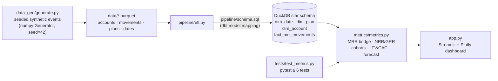

# SaaS Metrics Dashboard

[](https://www.python.org/)
[](https://duckdb.org/)
[](https://streamlit.io/)
[](LICENSE)

An executive SaaS revenue dashboard built on a proper analytics-engineering
foundation: seeded synthetic subscription events flow through an ETL pipeline
into a DuckDB star schema, a metrics layer computes the standard SaaS KPI set,
and a Streamlit + Plotly app presents it — KPI cards, an MRR waterfall,
cohort retention heatmap, churn drilldown, and a labelled forecast.

## Live demo

🚀 **Live demo:** https://saas-metrics-dashboard.streamlit.app/

## Features

- **Seeded, deterministic data** — ~2,000 accounts, 3 plans, 2 regions, 24 months of
  signups, upgrades, downgrades, churns and reactivations from a fixed numpy seed.
  No API keys, no downloads; every run is byte-identical.
- **Star schema in DuckDB** — `dim_date`, `dim_plan`, `dim_account`,
  `fact_mrr_movements`, with a documented Snowflake/dbt model mapping in
  `pipeline/schema.sql`.
- **Exact MRR arithmetic** — all money is integer cents, so
  `beginning + new + expansion − contraction − churn == ending` holds exactly,
  verified by tests.
- **Full SaaS KPI set** — MRR, ARR, NRR, GRR, logo churn, revenue churn, ARPA,
  LTV, LTV:CAC, CAC payback.
- **Cohort retention heatmap** — monthly cohorts × months-since-signup; values
  are bounded [0, 1] and non-increasing (churned accounts never resurrect —
  reactivations are modelled as brand-new account rows).
- **Churn drilldown** — trailing-3-month churn rate by plan tier and region,
  plus top synthetic exit-survey reasons.
- **Forecast panel** — 6-month MRR band extrapolated from the trailing-6-month
  NRR trend, explicitly labelled as trend extrapolation rather than a
  predictive model.
- **Tested** — pytest suite covering the MRR identity, sign conventions,
  retention invariants, no-zombie-accounts, and fact-to-bridge consistency.

## Architecture



## Quickstart

```bash
pip install -r requirements.txt

# 1. Generate the seeded dataset (data/*.parquet)
python -m data_gen.generate

# 2. Load it into the DuckDB star schema (data/saas_metrics.duckdb)
python -m pipeline.etl

# 3. Run the dashboard (builds the DuckDB warehouse on first run if missing)
streamlit run app.py

# 4. Run the test-suite
pytest
```

All commands run from the project root. The pipeline completes in well under
a minute on a laptop.

Or with Docker:

```bash
docker build -t saas-metrics-dashboard .
docker run -p 8501:8501 saas-metrics-dashboard
```

## Dashboard panels

1. **KPI row** — MRR, ARR, NRR, GRR, logo churn and LTV:CAC for the selected
   month, each with a month-on-month delta.
2. **MRR bridge** — waterfall from starting MRR through +new, +expansion,
   −contraction, −churn to ending MRR.
3. **Cohort retention heatmap** — retention % by signup cohort and tenure.
4. **Churn drilldown** — churn rate by plan tier and region; top exit-survey
   codes; filterable to NA/EU in the sidebar.
5. **Forecast** — 6-month MRR band from the trailing-6-month NRR trend,
   labelled as trend extrapolation.
6. **Account table** — searchable, sortable account-level view (plan, MRR,
   tenure, status, channel).

## Project structure

```
saas-metrics-dashboard/
├── app.py                  # Streamlit + Plotly dashboard (6 panels)
├── data/                   # generated: *.parquet + saas_metrics.duckdb
├── data_gen/
│   └── generate.py         # seeded event generator (seed=42, deterministic)
├── pipeline/
│   ├── etl.py              # parquet -> DuckDB star schema loader
│   └── schema.sql          # DDL with Snowflake/dbt model mapping
├── metrics/
│   └── metrics.py          # KPI set: bridge, NRR/GRR, cohorts, LTV/CAC, forecast
├── tests/
│   └── test_metrics.py     # 9 tests: MRR identity, retention bounds, no zombies…
├── requirements.txt
├── Dockerfile
├── .gitignore
└── LICENSE                 # MIT
```

## Modelling notes

- **Money is integer cents everywhere** until presentation time — the MRR
  bridge balances to the cent, with no float drift.
- **No zombie accounts**: once an account churns it stays churned. Winbacks
  are new account rows (`is_reactivation = TRUE`) linked to the original via
  `original_account_id`, which keeps cohort retention monotone.
- **Forecast honesty**: the 6-month projection is a linear extrapolation of
  the trailing NRR trend with a widening band — the dashboard labels it as
  such rather than implying a predictive model.

## Production extensions

How this would grow into a production analytics stack:

- **dbt + Snowflake/BigQuery** — the `schema.sql` comments already map each
  table to its dbt mart model; promote the pandas transforms to versioned
  dbt models with tests and docs.
- **Orchestration** — schedule `generate → etl` on Airflow/Dagster with
  incremental loads (merge on `movement_id`) instead of full rebuilds.
- **Data quality** — Great Expectations / dbt tests on the bridge identity,
  FK integrity and retention bounds, alerting on breach.
- **Real event sources** — swap the seeded generator for Stripe/Billing webhooks
  landing in an append-only raw zone (S3 + Iceberg/Delta).
- **Forecasting** — replace the trend extrapolation with Prophet/ETS or a
  hierarchical model, backtested and versioned in MLflow.
- **Serving** — cache the metrics layer (Redis/Parquet mart), add auth and
  row-level security before exposing the dashboard company-wide.
